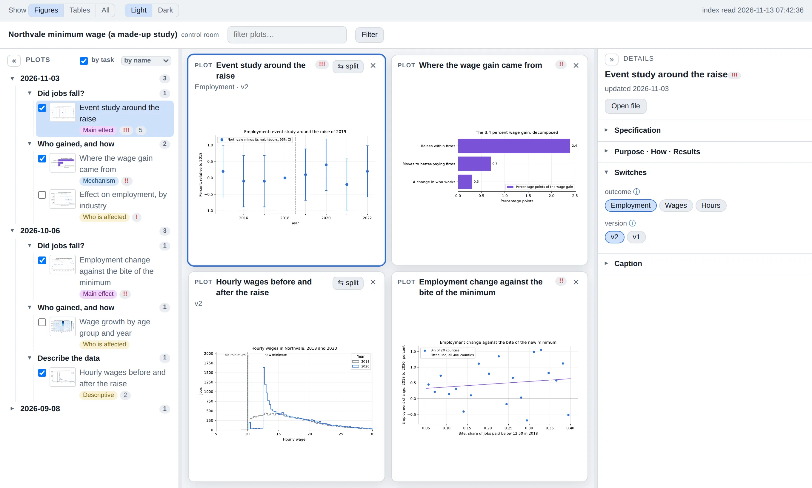

# ResearchRoom

A dashboard for an empirical research project. It reads the figures and tables your scripts already write, and shows
them as a *room*: one card per plot, its versions and variants behind switches, grouped by the date you read each
result. You run it on your own project; nothing is uploaded unless you publish it yourself.
On a card with several versions, `⇆ v1` opens the older version beside it (cards of one plot zoom together) and `◐`
flips the two in place, so small changes stand out.



## What you need
- Python 3.11 or newer, and poppler (`pdftoppm`) to show PDF figures: `apt install poppler-utils` or `brew install poppler`.
- Nothing else for local use: the server is standard library only.
- Only to publish: node (`npx wrangler`). Only for the Claude panel: `claude-agent-sdk`, and `pyjwt` for the web room.

## Try it
```
git clone <this repository's URL> ResearchRoom
python3 ResearchRoom/room/dashboard.py --project ResearchRoom/example
```
Open http://127.0.0.1:8765/room. The example is a made-up study of a minimum-wage rise in an invented region, drawn by
`example/make.py`: nine plots from three sittings, with versions, switches, equations, captions, and the `.room/` files
that name, tag and explain them. A link can open cards: `/room?open=<plot id>&open=<plot id>`. For your own project,
clone this repository beside it and run, from the project folder:
```
python3 ../ResearchRoom/room/dashboard.py --project .
```

## What the dashboard expects from a project
- **Required:** a `figures/` or a `tables/` folder, with outputs named `N_name_vK.ext`: `N` is a script number of two
  or three digits and `K` the version, as in `02_shares_v1.png`. The newest version is shown; older ones are flagged
  `superseded` at `/all`.
- **Optional, and switched on by being there:** `code/local/N_name_vK.py` (the script that writes the outputs
  numbered `N`: its link, and a flag when an output needs a rerun, see below); `docs/findings.md` (the overview at `/`;
  format in `example/docs/findings.md`); `docs/runs/readout_<date>_<label>.md` and `out/N_name_vK/RELEASE/` (results
  that come back from a restricted-data site, dated by the commit that added the read-out); `docs/log/`.
  An output whose number no script carries is a plot of its own. We note one limit: a file not named `N_name_vK.ext`,
  or one whose number several scripts carry while none matches its first word, is listed at `/all` only; the export
  names each such file.
- **A sitting's brief** (optional): `docs/runs/takeaways_<read date>.md`, opened at `/room?brief=<read date>` (the
  room's tree links it from that date). One `## N. <the ask, as a question or sentence>` per point, then these lines:
  `ask: <who and when> | <https link>` (or `ask: <who and when>`, or `ask: none` for a result nobody asked for, listed
  under "Also found"), `exhibit: <file>` (the plot the room opens) and `also: <file>, <file>`, then the text. A
  `## Still open` section lists the asks that sitting did not answer, `- <text> | <https link>` a line. The room
  flags any number in the text that no read-out of that date gives. Example: `example/docs/runs/takeaways_2026-11-03.md`.
  With the Claude panel, the owner also gets a chat column there: one resumable chat per sitting (`+ New` and a menu
  of earlier ones), saved in `.room/chats/`, which ignores itself, never in `docs/qa/` and never shown to coauthors.
- **Files a figure script may write beside an output** (`<stem>` is the file name without its extension):
  `<stem>.txt`, the caption; `<stem>.eq.json`, the estimating equation as `{"eq": "<TeX>", "notes": [...]}`;
  `<stem>.variant.json`, the family a figure belongs to and its option on each switch; `<stem>.ptype`, the plot type;
  `<stem>.layers.svg`, the same page as an SVG whose series can be switched off: each series' marks carry the id
  `ser-<i>-<j>`, its legend text and handle `ser-<i>-leg` and `ser-<i>-legh`, and the root lists the labels as
  `data-series`. The room shows it in place of the image, with one chip per series; `example/make.py` writes one.

## The project's own data: `.room/`
The dashboard keeps what belongs to your project in `.room/`, inside the project: titles, tags, tasks and the like as
tab-separated files, your icons, and `config.toml`. Every setting is optional. `example/.room/config.toml` lists all of
them with a comment each; a key that is not on that list stops the dashboard with a message that names it.

**Which outputs need a rerun.** The room records in `.room/runs.tsv` (commit it) the md5 of each newest output and of
what it was made from when it was written: its script version, plus what you list in `.room/inputs.tsv`, one line per
script, `N<TAB>path or glob, ...` (`*` for every script, for shared helpers; `#` starts a comment). An output whose
sources changed since is flagged `stale`, and so is any output that reads it; hover the flag for the reason. An output
with no record yet is flagged `older` when a source is newer than it, by date. `python3 room/dashboard.py --project .
--check` lists them all and exits 1 if there are any; in a pre-push hook, add `|| true` to warn without blocking. We
note two limits: a comment-only edit of a script counts as a change, and a rerun that writes the same bytes keeps the
flag.

## Publishing (optional)
`--export DIR` writes the room as static files that any static host can serve. The built-in recipe is Cloudflare Pages
behind Cloudflare Access:
1. Create a Pages project and an Access application that covers its hosts (plus a Bypass rule for `/favicon.ico` and
   `/apple-touch-icon.png`, which browsers fetch without a login).
2. Fill in `[hosted]` in `.room/config.toml`.
3. Run `python3 ../ResearchRoom/room/dashboard.py --project . --publish`.

Publishing refuses to deploy unless each listed host still redirects to your Access login. After a deploy it also
checks the deployment's own address (`<hash>.<project>.pages.dev`, which every deploy gets): Access must cover it, or
the site's middleware must refuse it. If neither holds, it says so and exits with an error. `.room/site/` is the publish
folder, a full copy of the export: add it to your `.gitignore`. We note one limit: file paths on the published copy keep
your script numbers and names; only the labelled name fields are blanked.

## The Claude panel (optional)
`uv run --with claude-agent-sdk python ../ResearchRoom/room/dashboard.py --project . --claude` adds a panel that
answers questions about a plot with Claude Code. It runs on the Claude Code login of whoever starts the server, with
that person's settings, and it can edit, commit and push in the project. It is for the project's owner only: do not
expose it to anyone else. Collaborators get the published copy, which has no panel.
You pick Opus or Sonnet and the effort for each question (Opus on medium by default). When an answer needs data or a
script the project does not have, Claude says so and offers an issue card; its button runs `gh issue create` in the
project, so it needs the GitHub CLI, logged in.
On a server, `tools/room-tunnel.sh` keeps one Cloudflare tunnel up for every room, and `tools/room-server.sh` keeps one
project's room up behind it, restarting it when its clone or the engine moves; their first lines give the cron lines.

The published copy can carry the Claude Q&A too, for everyone its Access app lets in. Set `[hosted] qa` to the room's
address: the publish then adds a Pages function that forwards the Q&A to the room, with a Cloudflare Access service
token (the Pages secrets `QA_CLIENT_ID` and `QA_CLIENT_SECRET`) and the reader's own Access login, which the room
checks (the room's env: `QA_SERVICE_ID`, the token's client id, and `PAGES_AUD`, the site's Access tag). The owner
(`[hosted] emails`) keeps the full panel. Everyone else gets a read-only Claude: it reads only a folder holding what
the site shows plus the tracked code, has no other tool and no approvals, and defaults to Sonnet. When the room is
down, the site works and the panel says so.

## Updating
`git pull` in your clone. `CHANGELOG.md` has one line for each change that asks you to do something.

## Developing
`tools/pre-push` runs the self-tests, exports the example, and runs `tools/clean-check.sh`, which keeps personal
details out of this repository. Install it once: `ln -s ../../tools/pre-push .git/hooks/pre-push`. MIT licence.
`tools/site.sh DIR` builds a static site (`landing/`, and the example's room at `/demo/`); `--deploy` publishes it.

Comments in the code cite dated notes (`docs/plans/…`, `DECISIONS`, `docs/lessons.md`, dates such as 10-20). They are the
design notes of the project the dashboard was first built in, and they are not in this repository.
